# 🗄️ Database-Hub

Created by **Darion Kellar** — open source under the MIT License

**Scouting bots scan the newest data from data centers, satellites, and ground feeds, plan inventions, build prototypes, run 3,000 tests, and deploy only the successful creations — into a 17-cloud + 17-SD-card + 17-Google-Drive storage mesh, served with zero network latency from local SD edge cache.**

---

## 🧰 Updated Workflows & Tech Stack Badges

[](https://github.com/credkellar/Database-HUB/actions)
[](https://github.com/credkellar/Database-HUB/actions)

> ⚠️ Honest status: the two workflow files (`ci.yml`, `docker-publish.yml`) are **paste-ready in the delivery pack but not on this repo yet** — the GitHub App cannot write workflow files, so these badges are static "pending paste" badges linked to the Actions page. The real workflow badges flip live on their own the moment both files are pasted into `.github/workflows/` (plural) and the per-repo Docker Hub secrets are set.

### 💻 Core Programming Languages & Core Systems


- 🐍 **Python 3.11+** — the whole system, one language
- 📦 **Zero dependencies** — standard library only (`hashlib` does the deterministic work)
- 🎯 **Deterministic everything** — same input, same output, every run, on every machine

### 🤖 Bots, Data & Storage Systems


- 🤖 **12 named scout bots**, one per domain
- 📡 **36 newest-data records** — data center, satellite, and ground feed sources
- 💾 **51 storage endpoints** — 17 clouds + 17 SD cards + 17 Google Drives

### ⛓️ Web3 & Infrastructure


- 🌐 **17 clouds in the mesh:** AWS S3, Google Cloud Storage, Azure Blob, Cloudflare R2, Backblaze B2, Wasabi, DigitalOcean Spaces, Oracle, IBM, Alibaba OSS, Tencent COS, Hetzner, MinIO, Storj, Filecoin, Arweave, IPFS
- ⛓️ **Decentralized storage included** — Storj, Filecoin, Arweave, and IPFS sit in the mesh as storage endpoints only. No token, no chain transaction, no wallet — signing a live transaction is a HOLD gate.

### ⚙️ Platform Support & Hardware Architecture


- 🐧 Linux / macOS / Windows (anywhere Python 3.11+ runs)
- 💳 Designed for a **17 × 1 TB SD-card edge array** — 17 TB of local storage
- 🐳 One Docker image, `python:3.11-slim`

### 🚀 DevOps & Build Tools


- ⚙️ **CI workflow** — pytest + self-checks + full pipeline on every push
- 🐳 **Docker Publish workflow** — builds and pushes `database-hub:latest` (needs per-repo `DOCKERHUB_USERNAME` / `DOCKERHUB_TOKEN` secrets)

---

## 📖 What is this about?

Database-Hub started with one question: **do data centers and satellites hold data?**

Yes — data centers hold almost all of the world's data permanently, and satellites collect fresh data from space and send it down. New data appears every second: weather snapshots, battery research, crop images, traffic patterns, security signals.

The problem is that new data just piles up. Nobody reads most of it, pairs it with data from other fields, or tests what could be built from it. Database-Hub is the machine that does that loop automatically — **scan the newest data, invent from it, build it, test it hard, and keep only what passes.**

## 🎯 What this does?

1. 📥 **Catalogs** 36 newest-data records across 12 domains from 3 source kinds
2. 🤖 **Scans** them with 12 named scout bots, one bot per domain
3. 🧹 **Filters** out stale records (older than 72 hours) and duplicates
4. 🏆 **Ranks** every finding by novelty + usefulness
5. 💡 **Plans** 12 inventions by pairing top findings from *different* domains
6. 🔨 **Builds** a deterministic prototype spec for each plan (data only, never executed)
7. 🧪 **Tests** every prototype with 250 checks — **3,000 tests total**
8. ✅ **Deploys only the winners** (pass rate ≥ 0.90) to the sandbox registry — 4 passed in the verified run
9. 💾 **Places** every creation on the 51-endpoint mesh: 1 SD card + 1 Google Drive + 1 cloud
10. ⚡ **Serves** reads from the SD edge cache first — zero network latency on a local hit

## ⚙️ How this works?

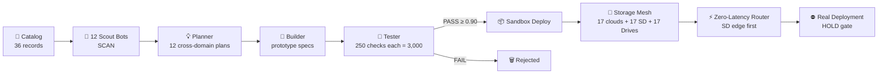

- **Cross-domain pairing is the invention trick.** A transport finding plus a materials finding makes something neither field would build alone.
- **The tester is honest.** Weak input data produces flawed prototypes, flawed prototypes fail most checks, and failures are never deployed — the verified run rejected 8 of 12.
- **Zero-latency means zero *network* latency.** Literal zero latency is physically impossible. Prefetching top findings onto all 17 SD cards means a local hit needs no network round-trip at all (0 ms network); a miss routes to the lowest-latency cloud in the model (MinIO, 5 ms).
- **Everything live is gated.** Live scanning, satellite commands, data-center access, real cloud sync, Google Drive access, and real deployment are all HOLD gates.

## 😎 Why is this cool?

1. 🤖 **It has a real bot fleet with names and jobs** — VoltScout hunts energy data, OrbitScout hunts space data, ShieldScout hunts security data.
2. 🛰️ **It treats satellites and data centers as one system** — space collects, Earth stores, the hub connects them.
3. 💡 **It invents across fields, not inside one** — cross-domain pairing is where new ideas actually come from.
4. 🧪 **It runs 3,000 tests before believing anything** — no prototype deploys on a good feeling.
5. 🗑️ **It rejects most of what it builds** — 8 of 12 prototypes failed and were thrown away in the verified run. That honesty is the feature.
6. 💾 **51 storage endpoints in one design** — 17 clouds, 17 SD cards, and 17 Google Drives working as one mesh.
7. 💳 **17 TB of edge storage on SD cards** — cheap, swappable, local, and fast.
8. ⚡ **Zero network latency on local hits** — the data you need most is already on the card next to you.
9. 🔁 **Every artifact survives any single loss** — SD + Drive + cloud copies, placed by hash.
10. ⛔ **It can do a lot and refuses a lot** — 12 HOLD gates mean the powerful actions stay under the owner's control.

## 🛠️ What problems this solves?

1. **Problem:** New data piles up unread. **Solution:** Scout bots scan and rank it automatically.
2. **Problem:** Good data goes stale before anyone uses it. **Solution:** Anything older than 72 hours is dropped; only the newest window is scanned.
3. **Problem:** Each field only reads its own data. **Solution:** The planner pairs findings across domains into inventions.
4. **Problem:** Ideas get built without proof they work. **Solution:** Every prototype must pass 250 deterministic checks first.
5. **Problem:** Weak ideas get deployed anyway. **Solution:** Below 0.90 pass rate means rejected — no exceptions, no manual override in code.
6. **Problem:** Files live in one place and die with it. **Solution:** 3-copy placement across SD, Drive, and cloud.
7. **Problem:** Cloud storage bills and outages hit one provider. **Solution:** A 17-cloud mesh spreads cost, risk, and copies.
8. **Problem:** Cloud reads are slow from far away. **Solution:** SD edge prefetch serves local hits with zero network latency.
9. **Problem:** Personal or paywalled data gets scraped by careless bots. **Solution:** Collection and scraping are HOLD gates; the catalog is synthetic and offline.
10. **Problem:** Automation deploys things nobody approved. **Solution:** Real deployment is a HOLD gate — sandbox only until the owner says go.

## 📥 How to install this? Step-by-step

1. 📋 Make sure you have **Python 3.11 or newer** (`python3 --version`)
2. 📥 Clone the repo: `git clone https://github.com/credkellar/Database-HUB.git`
3. 📂 Enter it: `cd Database-HUB`
4. ▶️ Run the full pipeline: `python3 main.py`
5. 🔍 See the scout findings alone: `python3 main.py scan`
6. 💾 See the storage mesh: `python3 main.py storage`
7. ✅ Run the self-checks: `python3 main.py checks`
8. 🧪 Run the tests: `pip install pytest` then `python3 -m pytest -q`
9. ⛔ Prove the safety gate: `python3 main.py --hold-demo` (exits with code 2 — real deployment held)
10. 🐳 Or run it in Docker: `docker build -t database-hub .` then `docker run --rm database-hub`

## 📋 Requirements?

- 🐍 **Python 3.11+**
- 📦 **Zero Python dependencies** for running (standard library only)
- 🧪 **pytest** — only for running the test suite
- 🐳 **Docker** — optional, only for the container run
- 💾 **For the full physical mesh (optional, future):** 17 × 1 TB SD cards and accounts on the clouds / Drives you choose — the software runs fully without them, because live sync is gated
- 🔑 **No API keys required** — nothing in this repo calls a live service

## 🧒 Explain in 5th grade English

Imagine a giant library that gets new pages every second — some pages come from big buildings full of computers, and some fall down from satellites in space.

Database-Hub sends out **12 robot helpers**. Each robot reads only the newest pages about one thing, like robots, weather, medicine, or space. Then the robots team up: one robot's page plus a different robot's page becomes a **new invention idea**.

Next, the invention gets a **big test — 250 questions**. If it gets almost all of them right, it gets saved in **three safe places at once**: a memory card, a Google Drive folder, and a cloud. If it fails the test, it goes in the trash. Nobody ships a failing invention.

The memory cards sit right next to the computer, so asking for saved work is **super fast — it doesn't have to travel across the internet at all**.

And the strongest rule: the robots are **never allowed** to touch a real satellite, sneak into a real data center, or put an invention into the real world. Only the owner can say yes to that.

## 🗺️ Mermaid flowchart for each script

### 📜 `main.py` — the one entry point

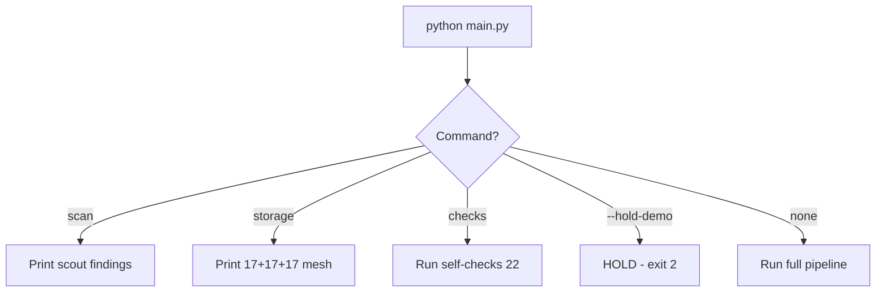

### 📦 `database_hub/__init__.py` — the package door

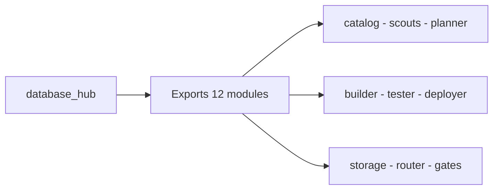

### 📡 `database_hub/catalog.py` — the newest-data catalog

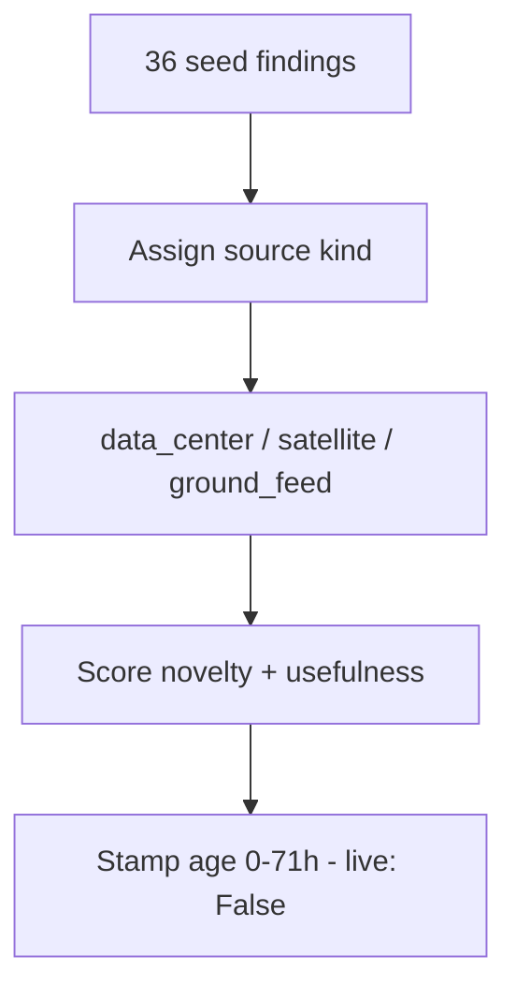

### 🤖 `database_hub/scouts.py` — the 12 scout bots

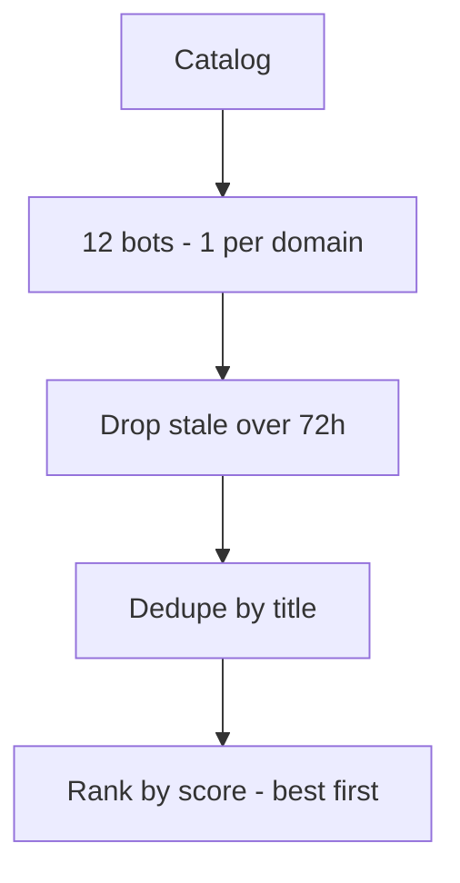

### 💡 `database_hub/planner.py` — the invention planner

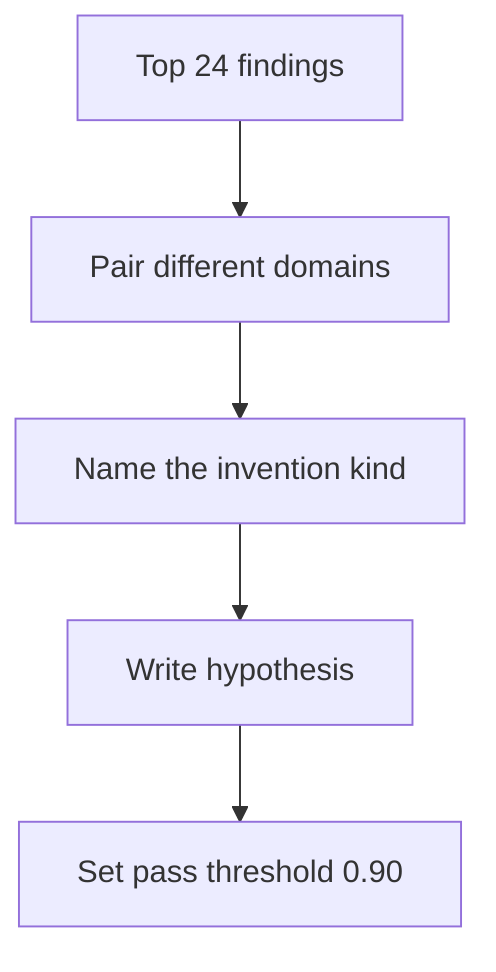

### 🔨 `database_hub/builder.py` — the builder

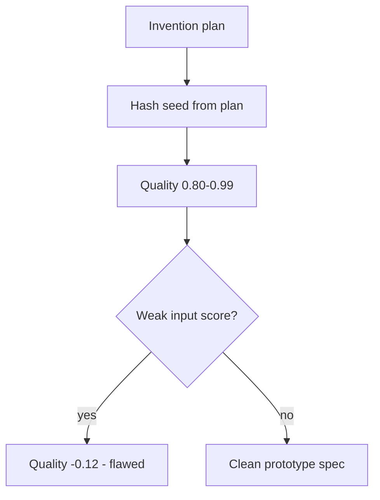

### 🧪 `database_hub/tester.py` — the 3,000-test battery

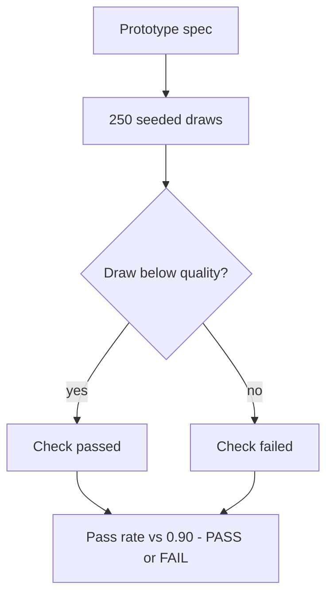

### 📦 `database_hub/deployer.py` — sandbox-only deployer

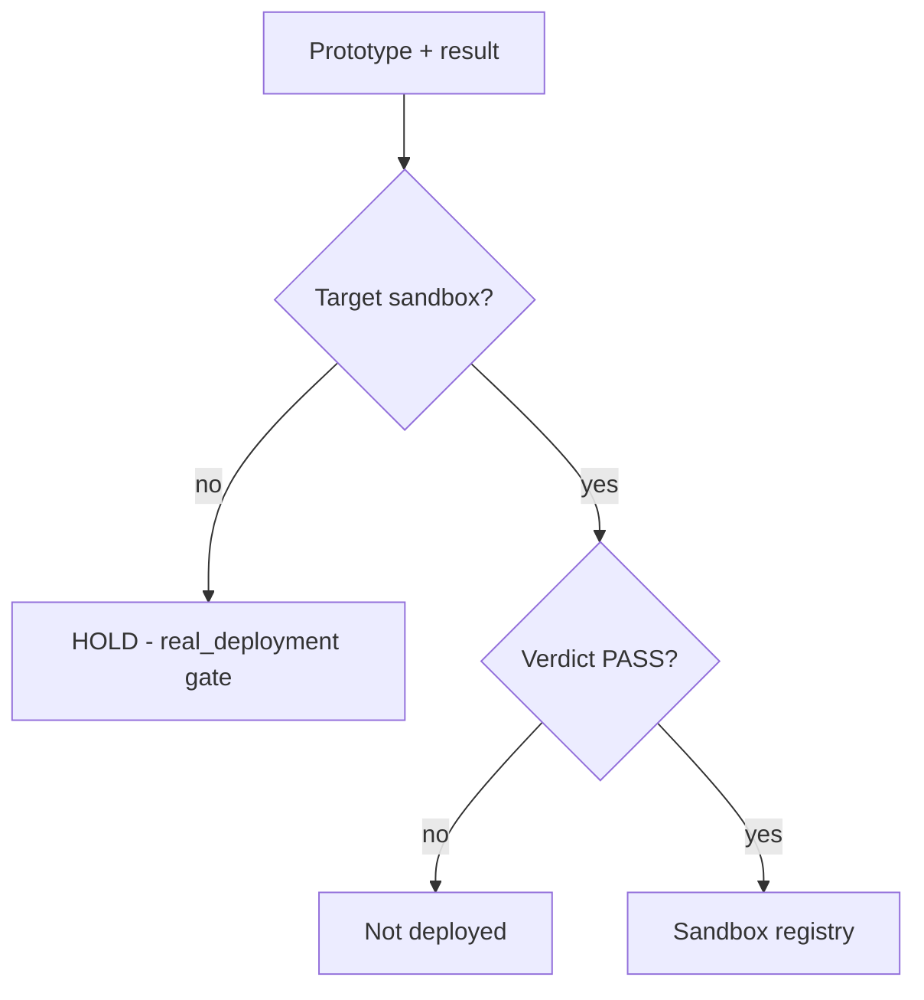

### 🔁 `database_hub/pipeline.py` — the full loop

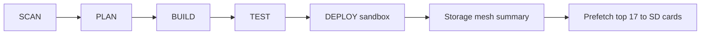

### ⛔ `database_hub/gates.py` — the 12 HOLD gates

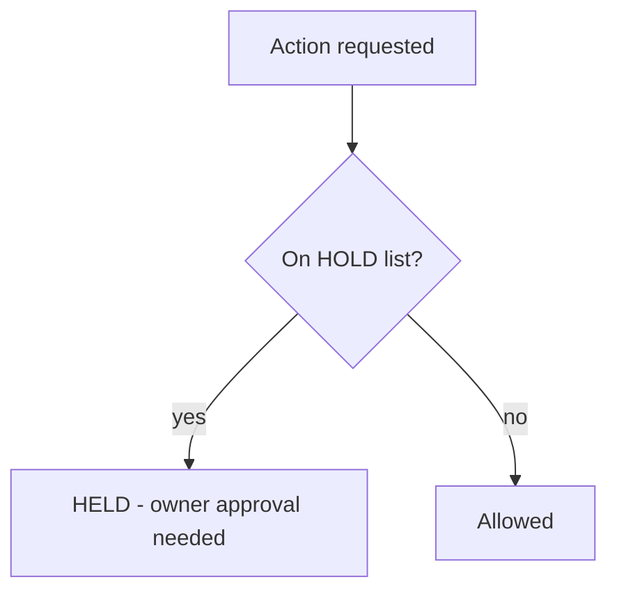

### 💾 `database_hub/storage.py` — the 51-endpoint mesh

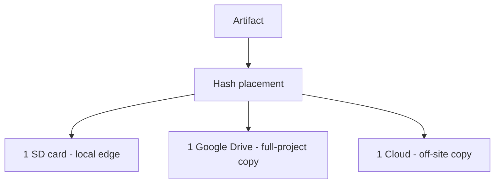

### ⚡ `database_hub/router.py` — the zero-latency router

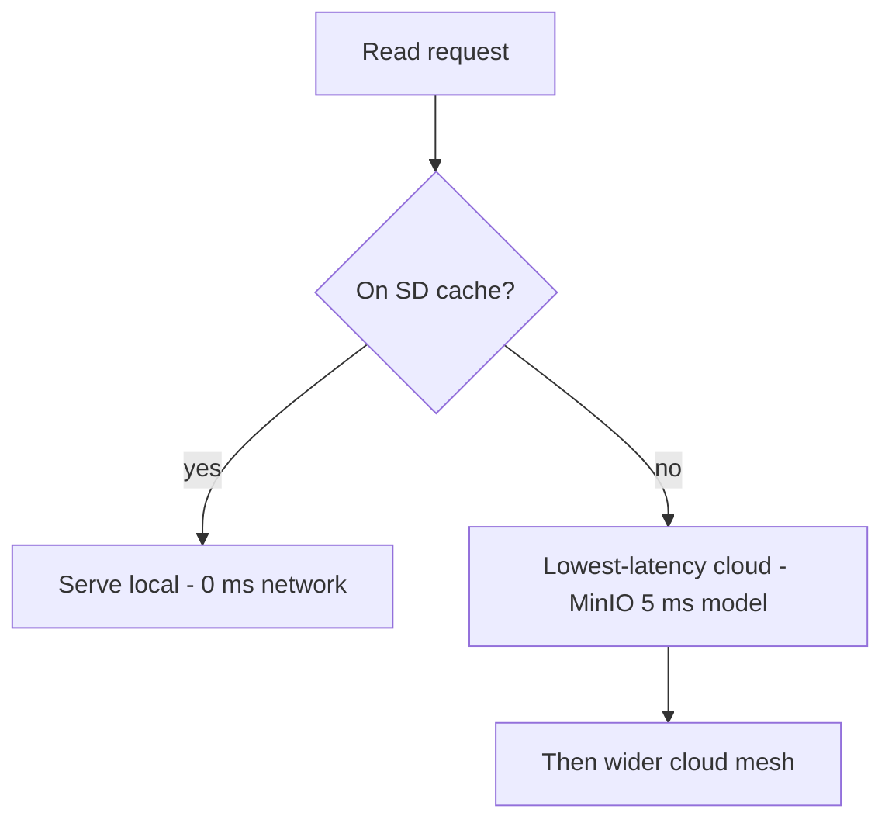

### 🧠 `database_hub/carbon4.py` — the Carbon 4 decider

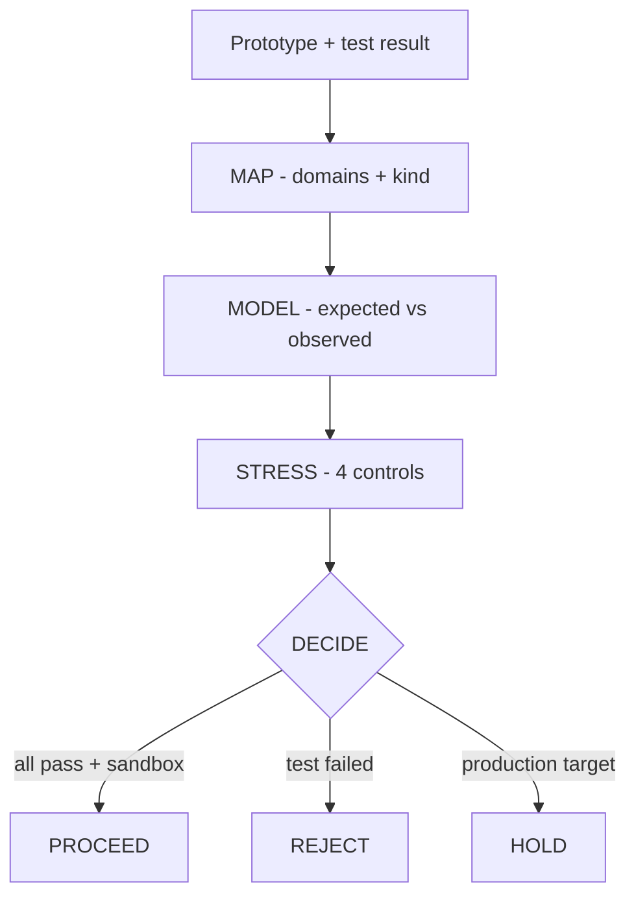

### 🌊 `database_hub/flows.py` — all 4 Google Flows

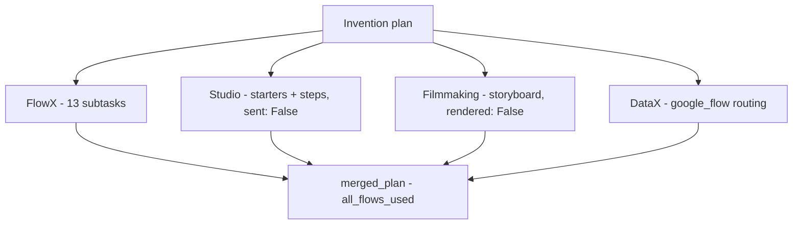

### 🧪 `tests/test_all.py` — the test suite

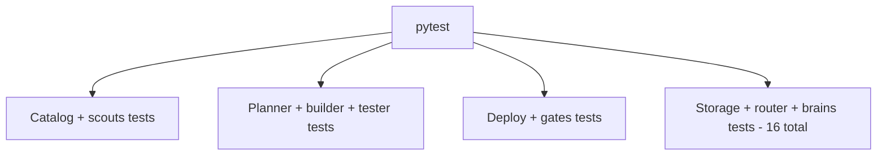


## 🧠 Brains & Flows

- 🧠 **Gemini Carbon 4 Extended Thinking — DECIDER.** MAP → MODEL → STRESS → DECIDE on every prototype, model `google/gemini-carbon-4-extended-pro-thinking`, tiers 2048 / 8192 / 32768 (32768 default). Offline-authoritative: `GEMINI_API_KEY` is detected by presence only, never read or sent, and a live call is a HOLD gate. Carbon can only tighten — a FAIL stays REJECT, a production target stays HOLD.
- 🌊 **Google Flows — all 4, on every plan.** FlowX runs a 13-subtask graph, Workspace Studio plans starters/steps (nothing sent), Flow Filmmaking plans a storyboard (rendered = False), and the DataX Flow engine routes each pair. `merged_plan` proves `all_flows_used` with 0 live calls.

## ✅ Verified run

```
findings scanned : 36
invention plans  : 12
prototypes built : 12
tests run        : 3000 (2624 passed)
prototypes PASS  : 4
deployed sandbox : 4 (successful creations only)
storage mesh     : 51 endpoints, prefetch on 17 SD cards
carbon 4 decider : 4 PROCEED, google flows: all 4 on every plan
```

- `pytest` — **16 passed**
- `python main.py checks` — **CHECKS 28/28**
- `python main.py --hold-demo` — **exit 2** (real deployment held)

## ⛔ HOLD gates (14)

`live_web_scan` · `satellite_command` · `datacenter_access` · `collect_personal_data` · `scrape_paywalled` · `real_deployment` · `live_hardware` · `clinical_use` · `spend_real_funds` · `sign_live_transaction` · `live_cloud_sync` · `google_drive_access` · `live_gemini_api_call` · `live_video_generation`

Nothing in this repo scans a live site, commands a satellite, enters a data center, collects personal data, syncs to a real cloud or Drive, or deploys to production. Passing creations deploy to the in-process sandbox registry only.

## 🌳 Full project

```
Database-Hub/
├── 📜 main.py                    # one entry point
├── 📁 database_hub/
│   ├── 📦 __init__.py            # package exports
│   ├── 📡 catalog.py             # 36 records, 12 domains, 3 source kinds
│   ├── 🤖 scouts.py              # 12 named scout bots, ranked scan
│   ├── 💡 planner.py             # cross-domain invention plans
│   ├── 🔨 builder.py             # deterministic prototype specs (data only)
│   ├── 🧪 tester.py              # 250-check battery per prototype
│   ├── 📦 deployer.py            # sandbox-only deploy, real deploy held
│   ├── 🔁 pipeline.py            # SCAN -> PLAN -> BUILD -> TEST -> DEPLOY
│   ├── 💾 storage.py             # 17 clouds + 17 SD (1 TB) + 17 Google Drives = 51
│   ├── ⚡ router.py               # zero-latency router: SD edge first
│   ├── 🧠 carbon4.py             # Carbon 4 DECIDER: MAP->MODEL->STRESS->DECIDE
│   ├── 🌊 flows.py               # all 4 Google Flows, plan-only
│   └── ⛔ gates.py               # 14 HOLD gates
├── 🧪 tests/test_all.py          # 16 tests
├── 🐳 Dockerfile
├── 📄 LICENSE
└── 📖 README.md
```
